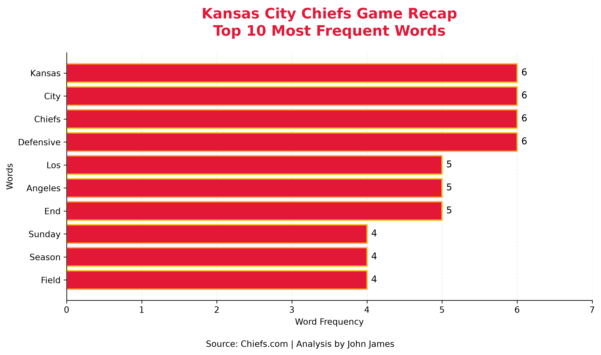

# nlp-05-web-documents

[](pyproject.toml)
[](https://github.com/johnjamez187/nlp-05-web-documents/actions/workflows/ci-python-zensical.yml)
[](https://johnjamez187.github.io/nlp-05-web-documents/)

[](https://docs.astral.sh/uv/)
[](https://docs.astral.sh/ty/)
[](https://zensical.org/)
[](LICENSE)

> Web Mining and Applied NLP - Module 5
> HTML Web Document Extraction and Analysis

**Author:** John James
**Date:** November 2026
**Repository:** https://github.com/johnjamez187/nlp-05-web-documents

## Project Overview

Author: John James

Date: 2026 November

Fifth project in the Web Mining and Applied NLP course.

This project introduces web document acquisition
and structured information extraction from HTML.

The goal is to retrieve a web page,
validate its document structure,
extract meaningful text and metadata,
and save the results for analysis.

The project extends the EVTL pipeline approach
introduced in Module 4 to work with HTML documents
rather than JSON API responses.

The project is configured in
[pyproject.toml](pyproject.toml).

## Data

The original example retrieves the academic research paper Agents of Chaos from arXiv.

For my technical modification experiment, I changed the data source to Graph Neural Networks to Predict Sports Outcomes.

I selected this research article because of my interest in football and sports analytics.

The source document contains information such as:

Paper title.

Authors.

Abstract.

Subject categories.

Submission information.

arXiv identifier.

The pipeline preserves the original HTML and produces a structured CSV dataset containing extracted metadata.

## Approach

The project uses a modular Python pipeline
to acquire, validate, transform, and save HTML data.

The pipeline has four stages:

- **Extract** - retrieve HTML from a web page.
- **Validate** - verify that required HTML elements exist.
- **Transform** - extract text and metadata into a structured dataset.
- **Load** - save the processed data to a CSV file.

The example uses Requests for HTTP acquisition,
BeautifulSoup for HTML parsing,
and Pandas for tabular data processing.

The Transform stage also calculates
derived fields such as abstract word count
and number of authors.

Explore these important project components:

- [pyproject.toml](pyproject.toml) - project identity, dependencies, and tool configuration.
- [src/nlp/pipeline_web_html.py](src/nlp/pipeline_web_html.py) - main EVTL pipeline orchestrator.
- [src/nlp/config.py](src/nlp/config.py) - example web page and path configuration.
- [src/nlp/stage01_extract.py](src/nlp/stage01_extract.py) - retrieve HTML.
- [src/nlp/stage02_validate.py](src/nlp/stage02_validate.py) - validate HTML structure.
- [src/nlp/stage03_transform.py](src/nlp/stage03_transform.py) - extract metadata and build a DataFrame.
- [src/nlp/stage04_load.py](src/nlp/stage04_load.py) - save processed results.
- [tests/](tests/) - automated tests.
- [.github/workflows/](.github/workflows/) - automated testing and documentation deployment.
- [docs/](docs/) - project documentation.
- [zensical.toml](zensical.toml) - documentation configuration.

The goal is to understand how information
is extracted from semi-structured web documents
and transformed into analysis-ready data.

## Run the Project

Follow the [Professional Python Workflow Guide](https://denisecase.github.io/pro-analytics-02/)
to set up your machine and project environment.

From a VS Code terminal in the project root:

```shell
uv run python -m nlp.pipeline_web_html
```

## Results

The pipeline retrieves an HTML document,
validates its structure,
extracts bibliographic information,
and writes the results to a CSV file.

The resulting dataset includes text and metadata
along with derived measures
such as abstract word count and author count.

Successful execution produces:

```shell
========================
Pipeline executed successfully!
========================
```

The following files are created:

- `project.log` - pipeline execution log.
- `data/raw/case_raw.html` - original HTML document.
- `data/processed/case_processed.csv` - extracted and transformed data.

These artifacts provide evidence of successful
HTML acquisition, validation, transformation, and persistence.

## Verification

Run the automated tests:

### Modification

I changed the PAGE_URL variable in src/nlp/config.py
to retrieve a research article related to sports analytics.

- Original source: https://arxiv.org/abs/2602.20021
- Modified source: https://arxiv.org/abs/2207.14124

### Prediction

I predicted that the article metadata, author count,
and abstract word count would change while the DataFrame
structure would remain one row and eight columns.

### Actual Results

| Attribute | Original | Modified |
| --- | --- | --- |
| Author count | 38 | 2 |
| Abstract word count | 177 | 204 |
| DataFrame rows | 1 | 1 |
| DataFrame columns | 8 | 8 |
| Tests passed | 2 | 2 |
| Code coverage | 75.15% | 75.15% |

The pipeline executed successfully, and the actual
results matched my predictions.

```shell
uv run python -m pytest
```


## Custom Application: Kansas City Chiefs Game Recap Analysis

**Author:** John James

**Date:** November 2026

### Project Purpose

My custom application applies the EVTL pipeline to a Kansas City
Chiefs game recap instead of an academic research article.

The goal is to identify frequently occurring words and investigate
which topics receive attention in the game recap.

### Data Source

The data was retrieved from the official Kansas City Chiefs website.

- [Chiefs Defeat Chargers, 22-6, to Move to 5-0 on the Season](https://www.chiefs.com/news/chiefs-defeat-chargers-22-6-to-move-to-5-0-on-the-season)

The article contains 17 nonempty paragraphs.

### Tools and Techniques

- Requests for HTML acquisition.
- BeautifulSoup for HTML parsing and validation.
- Pandas for structured data processing.
- Regular expressions for tokenization.
- Lowercase normalization.
- Stop word removal.
- Counter for word frequency analysis.
- Matplotlib for data visualization.
- pytest for automated verification.
- uv for environment and dependency management.

### Customized Python Files

The custom application uses separate Python files to preserve
the original pipeline and technical modification experiment.

- [config_james.py](src/nlp/config_james.py) - custom configuration.
- [stage02_validate_james.py](src/nlp/stage02_validate_james.py) - article validation.
- [stage03_transform_james.py](src/nlp/stage03_transform_james.py) - text analysis.
- [pipeline_web_html_james.py](src/nlp/pipeline_web_html_james.py) - custom pipeline.
- [visualize_james.py](src/nlp/visualize_james.py) - word frequency visualization.
- [test_james.py](tests/test_james.py) - custom automated tests.

The original Extract and Load stages are reused without modification.

### Run the Custom Application

From the project root, initialize the environment:

```shell
uv sync
```

Run the customized Chiefs EVTL pipeline:

```shell
uv run python -m nlp.pipeline_web_html_james
```

Generate the visualization:

```shell
uv run python -m nlp.visualize_james
```

Run the automated tests:

```shell
uv run pytest -q
```

### Generated Files

- `data/raw/chiefs_raw.html` - extracted HTML.
- [chiefs_processed.csv](data/processed/chiefs_processed.csv) - structured analysis results.
- [chiefs_word_frequency.png](docs/images/chiefs_word_frequency.png) - visualization.

### Custom Application Results

| Metric | Result |
| --- | ---: |
| Article paragraphs | 17 |
| Total word tokens | 668 |
| Cleaned word tokens | 355 |
| Unique cleaned words | 245 |
| Word tokens removed | 313 |
| Preprocessing reduction | 46.86% |
| DataFrame rows | 1 |
| DataFrame columns | 7 |

### Visualization



### Key Finding

The word "defensive" appeared six times, tying with Kansas,
City, and Chiefs as the most frequently occurring cleaned words.

This suggests that defensive performance received notable
attention in the game recap.

Text preprocessing removed 313 word tokens, reducing the
original word token count by approximately 46.86%.

### Verification Results

| Verification | Result |
| --- | ---: |
| Original tests passed | 2 |
| Custom tests passed | 3 |
| Total tests passed | 5 |
| Failed tests | 0 |
| Required code coverage | 20% |
| Actual code coverage | 65.55% |
| Custom validation coverage | 100% |
| Custom transformation coverage | 100% |

All four EVTL stages executed successfully, and the
visualization was generated from the processed CSV file.

### Limitations and Future Improvements

This analysis uses only one game recap and therefore
does not represent the entire Kansas City Chiefs season.

Individual words are analyzed separately, which separates
phrases such as Kansas City and defensive end.

Future improvements could include analyzing multiple game
recaps, incorporating bigram analysis, comparing offensive
and defensive terminology, and identifying changes in
word frequency throughout the season.

The original arXiv pipeline remains available and can be run
independently of the custom Chiefs application.


## Project Documentation

The [hosted documentation site](https://johnjamez187.github.io/nlp-05-web-documents/)
is published using Zensical and GitHub Pages.

The documentation site is used to present the project report,
covering such sections as data, methods, results, visualizations,
interpretation, and conclusions.

## CI/CD and GitHub Actions

This project includes continuous integration and continuous deployment (CI/CD)
to check project files and publish the docs.

GitHub Actions include:

- [CI: Python and Documentation Checks](https://github.com/johnjamez187/nlp-05-web-documents/actions/workflows/ci-python-zensical.yml)
- [CD: Documentation Deployment](https://github.com/johnjamez187/nlp-05-web-documents/actions/workflows/deploy-zensical.yml)

## Developer Reference

Follow the
[Professional Python Workflow Guide](https://denisecase.github.io/pro-analytics-02/)
for **detailed instructions and troubleshooting**.

### Initialize and Update the Python Environment

With the project open in VS Code, open a VS Code terminal.
Paste each command and hit Enter or Return after to run it.

```shell
uvx pup-clean --delete
uv self update
uv python pin 3.14
uv python install
uv lock --upgrade
uv sync
uv audit
```

### Set Up and Run Git Hooks

Set up and run the git hooks to perform
basic checks automatically before
any changes get pushed to GitHub.

In the VS Code terminal,
paste each command and hit Enter or Return after to run it.

```shell
uvx prek install --force
uvx prek update --freeze --cooldown-days 7

git add -A
uvx prek run --all-files
# repeat if changes were made
uvx prek run --all-files
```

### Run Common Chores

Run linters, formatters, type checks, tests, and
build the documentation.

```shell
uv run ruff check . --fix
uv run ruff format .

uv run ty check
uv run python -m pytest
uv run python -m zensical build
```

### Git add-commit-push to GitHub

After making useful changes, save your work to GitHub.

```shell
git add -A
git commit -m "describe your changes in quotes"
git push -u origin main
```

## Developer Notes

- Use the **UP ARROW** and **DOWN ARROW** in the terminal to scroll through past commands.
- Use `CTRL+f` to find (and replace) text within a file.

## Developer Tools

This project uses professional Python tools to support development,
testing, documentation, and code quality.

- [uv](https://docs.astral.sh/uv/) - Python environments and dependencies.
- [Ruff](https://docs.astral.sh/ruff/) - Python linting and formatting, configured in [.ruff.toml](.ruff.toml).
- [ty](https://docs.astral.sh/ty/) - Python type checking.
- [pytest](https://docs.pytest.org/) - automated Python testing, configured in [.pytest.toml](.pytest.toml).
- [prek](https://prek.j178.dev/) - Git hooks and automated checks, configured in [prek.toml](prek.toml).
- [Zensical](https://zensical.org/) - project documentation, configured in [zensical.toml](zensical.toml).

## Links

- [Hosted Documentation](https://johnjamez187.github.io/nlp-05-web-documents/)
- [Professional Python Workflow Guide](https://denisecase.github.io/pro-analytics-02/)
- [Citation](CITATION.cff)
- [License](LICENSE)
