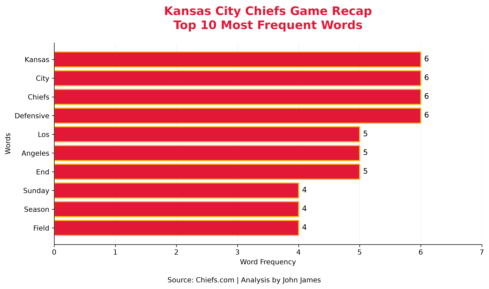

# Kansas City Chiefs Game Recap Analysis

Web Mining and Applied NLP | Project 05 | Custom Project Report

John James

November 2026

## Overview

This project applies web mining and natural language processing
techniques to a Kansas City Chiefs game recap.

The objective is to retrieve an HTML document, validate its structure,
extract meaningful article text, analyze word frequencies, and save
the results for further analysis.

This project extends the EVTL architecture introduced in Module 4
from structured JSON API responses to semi-structured HTML documents.

Unlike the original example, which extracts academic research
metadata from arXiv, my customized application analyzes the
language used in a professional football game recap.

## Analytical Question

Which words and topics receive the most attention in a
Kansas City Chiefs game recap?

I also wanted to investigate how text preprocessing affects
the number of words available for natural language processing.

## Data Source

The article was retrieved from the official Kansas City Chiefs website.

[Chiefs Defeat Chargers, 22-6, to Move to 5-0 on the Season](https://www.chiefs.com/news/chiefs-defeat-chargers-22-6-to-move-to-5-0-on-the-season)

The extracted article contains 17 nonempty paragraphs and
668 word tokens before preprocessing.

I selected this article because of my interest in the Kansas
City Chiefs, football performance, and sports analytics.

## Tools and Methods

The project uses:

- Python for pipeline orchestration and processing.
- Requests for retrieving HTML documents.
- BeautifulSoup for parsing and validating HTML.
- HTML selectors for locating article paragraphs.
- Regular expressions for text tokenization.
- Lowercase normalization for consistent word comparison.
- Stop word removal for reducing common words.
- Counter for calculating word frequencies.
- Pandas for structured data transformation.
- Matplotlib for data visualization.
- CSV for persistent output.
- Logging for execution records.
- pytest for automated testing.
- uv for environment and dependency management.
- Zensical and GitHub Pages for published documentation.

## EVTL Pipeline

The customized pipeline implements four stages.

### Stage 1: Extract

Retrieve the HTML document from the Kansas City Chiefs website
and save the original HTML for processing.

### Stage 2: Validate

Use BeautifulSoup to verify that the document contains:

- A nonempty page title.
- An article element.
- Nonempty article paragraphs.

Validation helps identify unexpected changes in website structure.

### Stage 3: Transform

Extract the article paragraphs and combine them into a single
body of text.

Convert the text to lowercase, tokenize the words, remove
stop words, and exclude words containing fewer than three letters.

Calculate the following attributes:

- Article title.
- Source URL.
- Paragraph count.
- Total word count.
- Cleaned word count.
- Unique cleaned word count.
- Top 10 most frequently occurring words.

Store the results in a Pandas DataFrame.

### Stage 4: Load

Save the transformed results to a structured CSV file
for visualization and subsequent analysis.

The original Extract and Load stages were reused without
modification.

Separate configuration, validation, transformation, and pipeline
files were created to preserve the original arXiv application.

## Results

The customized EVTL pipeline successfully retrieved,
validated, transformed, and saved the article data.

| Metric | Result |
| --- | ---: |
| Article paragraphs | 17 |
| Original word tokens | 668 |
| Cleaned word tokens | 355 |
| Unique cleaned words | 245 |
| Word tokens removed | 313 |
| Preprocessing reduction | 46.86% |
| DataFrame rows | 1 |
| DataFrame columns | 7 |

### Top 10 Most Frequent Words

| Word | Frequency |
| --- | ---: |
| Kansas | 6 |
| City | 6 |
| Chiefs | 6 |
| Defensive | 6 |
| Los | 5 |
| Angeles | 5 |
| End | 5 |
| Sunday | 4 |
| Season | 4 |
| Field | 4 |

## Visualization

The horizontal bar chart displays the ten most frequently
occurring words after text preprocessing.

Kansas City Chiefs red and gold were selected to connect
the visualization with the subject of the analysis.

The horizontal layout makes the word labels and frequency
counts easy to read and compare.

## Interpretation and Key Findings

The words Kansas, City, Chiefs, and defensive each appeared
six times.

The frequency of defensive suggests that defensive
performance received notable attention in the game recap.

The presence of Los and Angeles also reflects the identity
of the opposing team.

Text preprocessing removed 313 word tokens, reducing the
original word token count by approximately 46.86%.

This demonstrates how preprocessing can reduce common
or less informative words and produce a more focused
dataset for NLP analysis.

However, word frequency alone does not determine the
importance, sentiment, or context of an individual word.

## Technical Modification

The original example retrieves academic research metadata
from arXiv.

My customized application instead retrieves a football
news article and performs natural language processing.

The validation stage was modified to locate article
elements and paragraphs.

The transformation stage was modified to calculate word
frequencies, remove stop words, and generate text
analysis metrics instead of academic metadata.

A separate visualization script generates a horizontal
bar chart from the processed CSV file.

## Verification

The customized pipeline successfully executed all four
EVTL stages.

The following artifacts were generated:

- `data/raw/chiefs_raw.html`
- `data/processed/chiefs_processed.csv`
- `docs/images/chiefs_word_frequency.png`

Three customized automated tests were added while preserving
the two original automated tests.

| Verification | Result |
| --- | ---: |
| Original tests passed | 2 |
| Custom tests passed | 3 |
| Total tests passed | 5 |
| Failed tests | 0 |
| Required code coverage | 20% |
| Actual code coverage | 65.55% |
| Custom configuration coverage | 100% |
| Custom validation coverage | 100% |
| Custom transformation coverage | 100% |

The automated tests verify successful HTML validation,
rejection of invalid HTML, accurate word counts, stop word
removal, word frequencies, and DataFrame structure.

The pipeline orchestrator and visualization were verified
through successful manual execution.

## Limitations

This analysis is based on a single game recap and cannot
represent the entire Kansas City Chiefs season.

The article was published by the official team website
and may emphasize different topics than independent
sports reporting.

Analyzing individual words separately also removes
context from phrases such as Kansas City, Los Angeles,
and defensive end.

Word frequency does not necessarily indicate whether
a topic was discussed positively or negatively.

The pipeline also depends on the website maintaining
a compatible HTML structure.

## Future Improvements

If I were to continue this project, I would:

- Collect multiple Kansas City Chiefs game recaps.
- Compare offensive and defensive terminology.
- Analyze word frequencies throughout an NFL season.
- Incorporate bigram analysis to preserve meaningful phrases.
- Compare team-published articles with independent reporting.
- Apply sentiment analysis to investigate article tone.
- Create additional visualizations comparing games and opponents.

## Conclusion

This project demonstrates how web mining and natural
language processing can transform semi-structured HTML
documents into meaningful, analysis-ready data.

The EVTL pipeline successfully extracted and analyzed
a Kansas City Chiefs game recap while preserving the
original academic research example.

The results demonstrate the effectiveness of text
preprocessing, structured data transformation, word
frequency analysis, and visualization in sports analytics.

## Project Links

- [GitHub Repository](https://github.com/johnjamez187/nlp-05-web-documents)
- [Project README](https://github.com/johnjamez187/nlp-05-web-documents/blob/main/README.md)
- [Custom Pipeline](https://github.com/johnjamez187/nlp-05-web-documents/blob/main/src/nlp/pipeline_web_html_james.py)
- [Custom Validation](https://github.com/johnjamez187/nlp-05-web-documents/blob/main/src/nlp/stage02_validate_james.py)
- [Custom Transformation](https://github.com/johnjamez187/nlp-05-web-documents/blob/main/src/nlp/stage03_transform_james.py)
- [Visualization Code](https://github.com/johnjamez187/nlp-05-web-documents/blob/main/src/nlp/visualize_james.py)
- [Processed Data](https://github.com/johnjamez187/nlp-05-web-documents/blob/main/data/processed/chiefs_processed.csv)
- [Custom Automated Tests](https://github.com/johnjamez187/nlp-05-web-documents/blob/main/tests/test_james.py)
- [Original Example Pipeline](https://github.com/johnjamez187/nlp-05-web-documents/blob/main/src/nlp/pipeline_web_html.py)

## Documentation Index

- **Home** - this landing page.
- [Project Instructions](project-instructions.md)
- [Glossary](glossary.md)

## Project Resources

- [Project Instructions](project-instructions.md)
- [Professional Python Guide](https://denisecase.github.io/pro-analytics-02/)
- [Professional Python Project Explainer](https://pup-pack.github.io/professional-python-project-explainer/)
